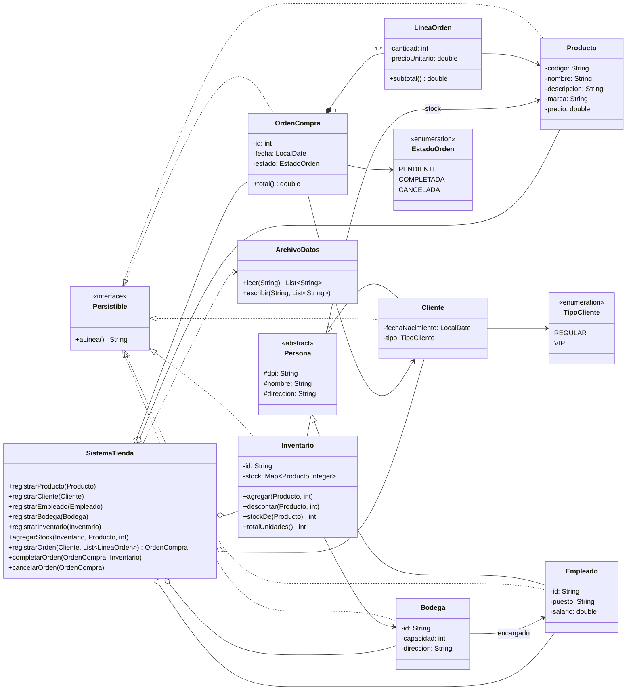
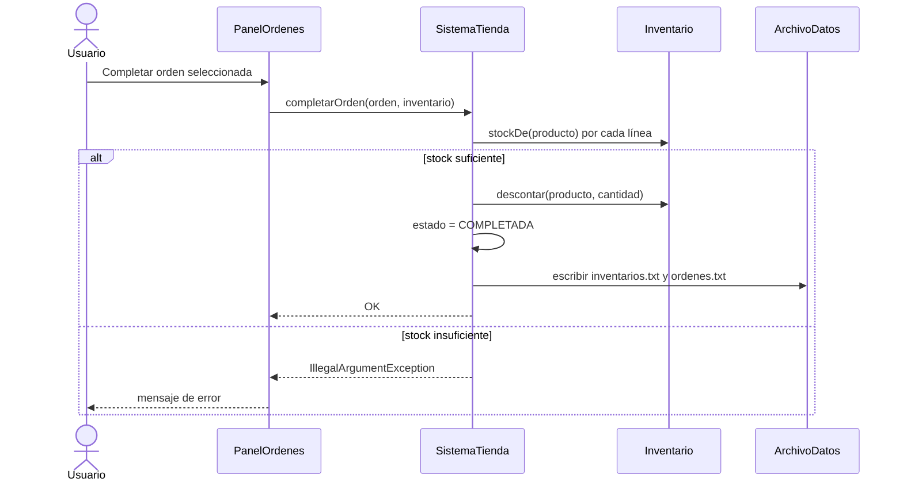

# Manual técnico

## 1. Descripción general
Aplicación de escritorio en Java con interfaz gráfica Swing. Sigue una arquitectura simple en capas:

| Capa | Paquete | Responsabilidad |
|------|---------|-----------------|
| Vista | `tienda.vista` | Ventanas y formularios; valida entradas del usuario |
| Servicio | `tienda.servicio` | Reglas de negocio (`SistemaTienda`) |
| Persistencia | `tienda.persistencia` | Leer/escribir archivos (`ArchivoDatos`) |
| Modelo | `tienda.modelo` | Clases del dominio |

## 2. Conceptos de POO aplicados
- **Encapsulamiento:** atributos privados con getters.
- **Herencia:** `Cliente` y `Empleado` extienden de la clase abstracta `Persona` (dpi, nombre, dirección).
- **Interfaz:** `Persistible` obliga a cada clase a saber convertirse en una línea de archivo (`aLinea()`).
- **Polimorfismo:** `SistemaTienda.guardar(...)` guarda cualquier lista de `Persistible`.
- **Composición/Asociación:** `OrdenCompra` tiene un `Cliente` y varias `LineaOrden`; `Inventario` tiene una `Bodega` y un mapa Producto→cantidad; `Bodega` tiene un `Empleado`.
- **Enumeraciones:** `TipoCliente` (REGULAR, VIP) y `EstadoOrden` (PENDIENTE, COMPLETADA, CANCELADA).

## 3. Diagrama UML de clases
(GitHub muestra este diagrama automáticamente. También puede pegarlo en https://mermaid.live para exportarlo como imagen.)

## 4. Persistencia en archivos
Se usan archivos de texto en la carpeta `datos/` (se crea sola). Cada línea es un registro y los campos se separan con `|`.

| Archivo | Formato de cada línea |
|---------|----------------------|
| `productos.txt` | `codigo\|nombre\|descripcion\|marca\|precio` |
| `clientes.txt` | `dpi\|nombre\|direccion\|AAAA-MM-DD\|tipo` |
| `empleados.txt` | `id\|nombre\|dpi\|direccion\|puesto\|salario` |
| `bodegas.txt` | `id\|idEmpleado\|capacidad\|direccion` |
| `inventarios.txt` | `id\|idBodega\|codProd:cantidad;codProd:cantidad` |
| `ordenes.txt` | `id\|dpiCliente\|fecha\|total\|estado\|codProd:cantidad:precio;...` |

- **Guardado:** cada vez que se registra o modifica algo, se reescribe el archivo correspondiente.
- **Carga:** al iniciar, `SistemaTienda.cargar()` lee los archivos en orden de dependencia (productos, clientes, empleados → bodegas → inventarios → órdenes).
- Por esto los campos de texto no pueden contener el símbolo `|` (la vista lo valida).

## 5. Reglas de negocio
1. No se permiten códigos/IDs/DPI duplicados.
2. Precio, salario y capacidad deben ser mayores que cero.
3. Una orden debe tener **al menos un producto**; nace en estado `PENDIENTE`.
4. **Completar una orden:** primero se valida que el inventario elegido tenga stock suficiente de *todos* los productos; si es así se resta el stock, se cambia el estado a `COMPLETADA` y se guardan inventarios y órdenes. Si falta stock no se modifica nada.
5. Solo se pueden completar o cancelar órdenes `PENDIENTE`.
6. Al agregar stock, el total de unidades de todos los inventarios de una bodega no puede superar su capacidad.

## 6. Flujo de completar una venta

## 7. Limitaciones y mejoras posibles
- No hay edición ni eliminación de registros (solo registro, según el alcance).
- Se podría guardar en JSON/CSV o base de datos, y agregar pruebas unitarias con JUnit.
